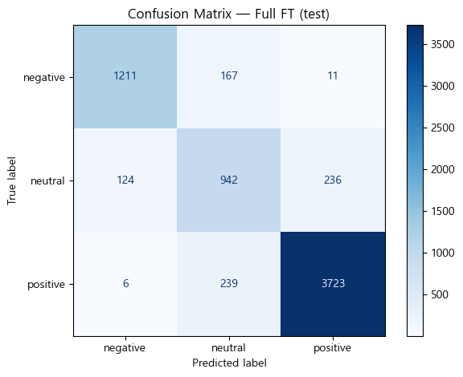
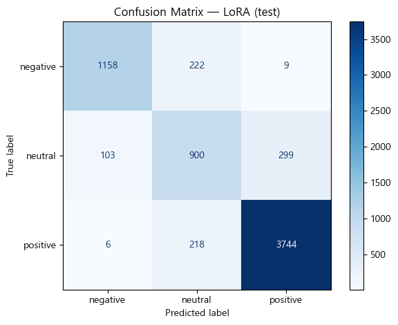

# PEFT vs Full Fine-Tuning 비교 — 쇼핑 리뷰 감성 분류

> **Bootcamp Mission 13** | NLP · 파인튜닝
> 자세한 설명: [Minseong Code Lab — 미션 13](https://minseong-code-lab.vercel.app/projects/mission-13-nlp-shopping-review-sentiment)

같은 데이터·같은 베이스 모델(`beomi/KcELECTRA-base`)로 Full Fine-Tuning과 LoRA를 학습해 비교했습니다.
LoRA는 **학습 파라미터를 약 4%(4.4M / 109M), 저장 용량을 16.9 MB로** 줄였고,
테스트셋 Macro F1은 Full FT보다 **0.0164 낮았습니다** (0.8454 → 0.8290).

## 데이터

쇼핑몰 패션 리뷰 44,397건, 3개 클래스(negative 20.9% · neutral 19.6% · positive 59.6%).
클래스 비율을 유지해 train 70 / val 15 / test 15로 나눴습니다.

## 실험 설정

| | Full Fine-Tuning | PEFT (LoRA) |
|---|---|---|
| 학습 대상 | 전체 파라미터 | `query` · `key` · `value` · `output.dense` 어댑터 + 분류 헤드 |
| LoRA 설정 | — | `r=32`, `alpha=64`, `dropout=0.05` |
| learning rate | 2e-5 | 1e-4 |
| 공통 | epoch 3 · batch 16 · max_length 128 | |

## 결과

노트북 최종 셀(`notebooks/mission13.ipynb`, 셀 10)의 출력입니다. 테스트셋은 마지막에 한 번만 평가했습니다.

| | Val Accuracy | Val Macro F1 | Test Accuracy | Test Macro F1 | 학습 시간 | 모델 크기 | 학습 파라미터 |
|---|---|---|---|---|---|---|---|
| Full Fine-Tuning | 0.8844 | **0.8489** | **0.8824** | **0.8454** | 871.5초 | 417.8 MB | 109,083,651 |
| PEFT (LoRA) | **0.8857** | 0.8472 | 0.8713 | 0.8290 | **766.7초** | **16.9 MB** | **4,426,755** |

<p>
  
  
</p>

## 결과에서 읽히는 것

- **검증셋만 봤다면 결론이 반대였습니다.** Val Accuracy는 LoRA가 근소하게 높지만(0.8857 vs 0.8844), 테스트셋에서는 Full FT가 Accuracy·Macro F1 모두 앞섭니다.
- **LoRA가 더 틀린 곳은 neutral 경계입니다.** 혼동 행렬에서 negative → neutral 오분류가 167 → 222건, neutral → positive가 236 → 299건으로 늘었습니다. 세 클래스 중 neutral의 F1이 가장 낮습니다 (Full FT 0.71, LoRA 0.68).
- 클래스가 불균형한 데이터라 Accuracy만으로는 이 차이가 잘 보이지 않아, Macro F1을 함께 봤습니다.

## 한계

- 시드를 바꿔 반복 실행하지 않았습니다. 위 차이가 실행 간 변동 범위 안인지 확인하지 못했습니다.
- LoRA 하이퍼파라미터는 한 조합만 시도했습니다.
- 학습 시간은 같은 환경에서 순서대로 잰 값이지만, GPU 상태까지 통제한 측정은 아닙니다.

이 미션에서 학습한 Full FT 모델은 [미션 16](https://github.com/malit9999/ai-model-format-conversion-mission-16)에서 양자화·ONNX 변환 대상으로 썼습니다.

## 실행 방법

```bash
pip install -r requirements.txt
jupyter notebook notebooks/mission13.ipynb
```

> 노트북 첫 셀의 데이터 경로(`DATA_DIR`)를 실행 환경에 맞게 바꿔야 합니다. 데이터는 저장소에 포함하지 않았습니다.

## 폴더 구조

```text
notebooks/
  mission13.ipynb
images/
  confusion_full_ft.png
  confusion_lora.png
README.md
requirements.txt
.gitignore
```

## 사용 기술

Python · PyTorch · Hugging Face Transformers · PEFT · scikit-learn · pandas
